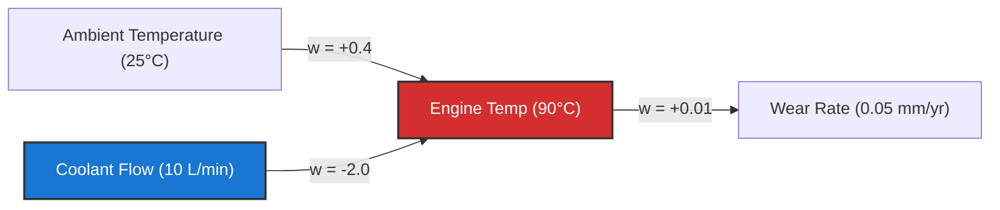

# AMATYA Causal & Counterfactual Reasoning (Phase 14.4)

## 1. Overview
The Causal Engine (`core/causal_engine.py`) implements Judea Pearl's Causal Hierarchy:
1. **Association ($P(y|x)$):** Observational correlations.
2. **Intervention ($P(y|do(x))$):** Active manipulation of system variables.
3. **Counterfactuals ($P(y_x|x', y')$):** Retrospective "what-if" reasoning.

---

## 2. Directed Acyclic Causal Graphs (`CausalGraph`)
- **Nodes (`CausalVariable`):** State variables with physical units, baseline values, and confounder flags.
- **Edges (`CausalLink`):** Directed mechanisms with partial derivatives $\frac{\partial Y}{\partial X}$, mechanism descriptions, and confidence levels.
- **Confounder Detection:** Automatically identifies common ancestral parents influencing both candidate variables:
  $$\text{Parents}(A) \cap \text{Parents}(B)$$

---

## 3. Pearlian Interventions: $do(X = x)$
When an intervention $do(X = x)$ is executed:
1. All incoming arrows into $X$ are severed (mutilated graph).
2. The perturbation $\Delta X = x - X_{base}$ is injected into $X$.
3. The delta propagates topologically downstream through mechanism links:
   $$\Delta Y = \Delta X \cdot w_{X \to Y}$$
4. Downstream confidence decays multiplicatively across multi-hop paths:
   $$C_{path} = \prod_{e \in path} c_e$$

When $do(\text{CoolantFlow} = 15\text{ L/min})$ is applied:
- $\Delta \text{CoolantFlow} = +5$
- $\Delta \text{EngineTemp} = +5 \times (-2.0) = -10.0^\circ\text{C}$ (New: $80^\circ\text{C}$)
- $\Delta \text{WearRate} = -10.0 \times 0.01 = -0.1\text{ mm/yr}$

