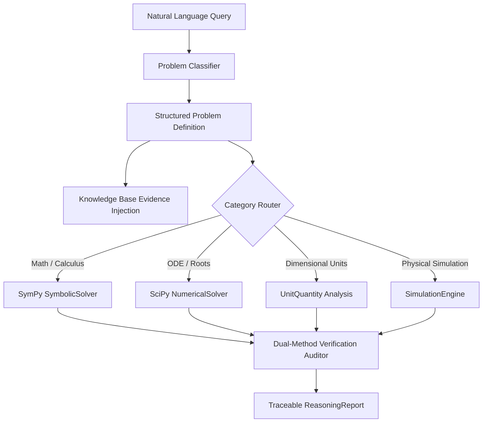

# AMATYA Reasoning Engine Architecture (Phase 14.2)

## 1. Executive Summary
The AMATYA Reasoning Engine (`core/reasoning_engine.py`) provides structured problem formulation, multi-category taxonomy routing, deterministic analytical solving, and transparent independent verification.

Under the fundamental architectural principle of Phase 14:
> **AMATYA must distinguish between knowing something, calculating something, predicting something, and proving something.**

The engine moves completely beyond loose text generation and hallucinated mathematical steps by transforming natural language queries into machine-readable intermediate problem definitions.

---

## 2. Problem Categorization Taxonomy
Incoming queries are classified across orthogonal reasoning categories:
1. **MATHEMATICAL:** Algebraic manipulation, calculus, limits, systems of equations, matrix operations.
2. **SCIENTIFIC:** Physical law propagation, chemical/biological modeling, dimensional checks.
3. **ENGINEERING:** Circuit analysis, structural load, thermal dissipation, component sizing.
4. **CAUSAL:** Root-cause analysis, counterfactual reasoning, intervention impact estimation.
5. **TEMPORAL:** Time-series trends, schedule dependencies, state evolution.
6. **CONSTRAINT:** Linear/nonlinear mathematical optimization, resource-bounded feasibility.
7. **PROBABILISTIC:** Uncertainty propagation, stochastic risk distributions, Monte Carlo trials.
8. **DECISION:** Multi-Criteria Decision Analysis (MCDA), Pareto frontier extraction.
9. **STRATEGIC:** Multi-phase planning, Critical Path Method (CPM), dependency graphs.
10. **DIAGNOSTIC:** Discrepancy isolation, anomaly detection, telemetry drift.
11. **COMPARATIVE:** Trade-off analysis, cross-scenario evaluation, sensitivity ranking.

---

## 3. Intermediate Representation: `ProblemDefinition`
Every problem is parsed into a structured, typed data structure:
```python
@dataclass
class ProblemDefinition:
    problem_id: str
    objective: str
    categories: list[str]
    givens: dict[str, Any]
    unknowns: list[str]
    assumptions: list[str]
    constraints: list[str]
    relevant_evidence: list[str]
    selected_methods: list[str]
    success_criteria: str
    analytical_steps: list[str]
```

### Deterministic Routing Pipeline


---

## 4. Verification & Audit Trail
Every computation includes:
- Verification Status: `Verified`, `Nominal`, `Hypothesis`, or `Discrepant`.
- Traceable Step History: Log of deterministic computational operations and solvers executed.
- Zero Leaks: Private model internal reasoning is never exposed to external logs.
- Markdown Generation: Standardized formatting for display in the AMATYA HUD.
