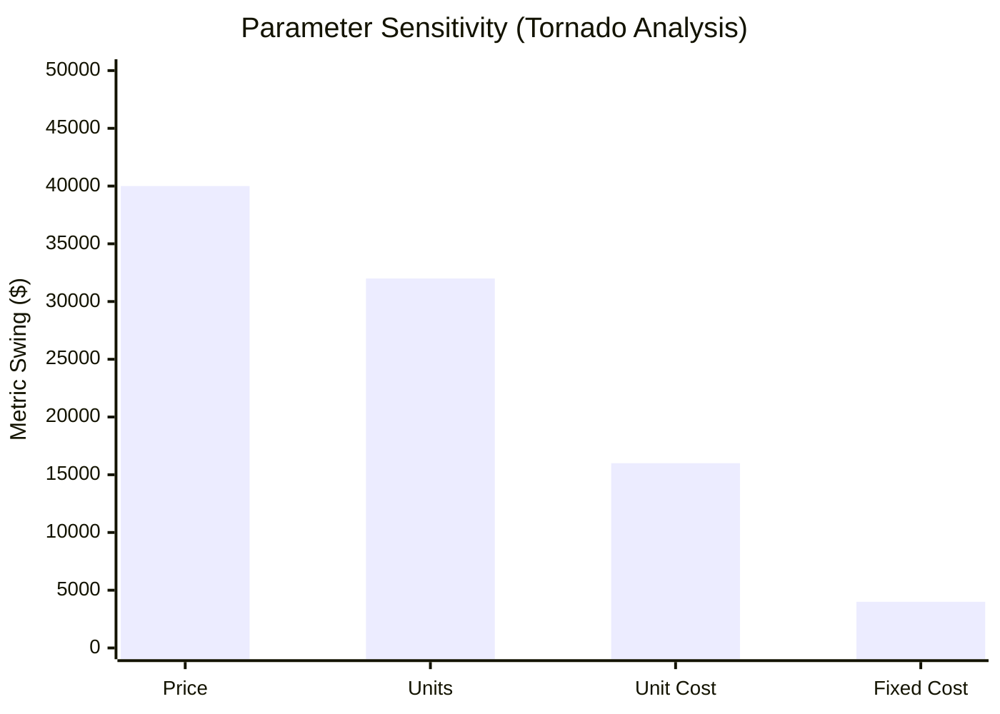

# AMATYA Scenario & Sensitivity Analysis Engine (Phase 14.8)

## 1. Overview
The Scenario Engine (`core/scenario_engine.py`) allows exploration of multi-scenario trade-offs, parametric sweeps, and sensitivity analysis.

---

## 2. Multi-Scenario Modeling
Scenarios represent structured variations of base operating parameters:
- **Base Scenario:** Reference operating state.
- **Optimistic Scenario:** Favorable boundary conditions (e.g. higher price, lower resistance).
- **Pessimistic Scenario:** Unfavorable conditions (e.g. supply shortage, thermal spike).
- **Stress-Test Scenario:** Extreme edge conditions verifying system safety limits.

---

## 3. Tornado Sensitivity Analysis
The engine evaluates local elasticity for every parameter $x_j$:
1. Perturbs $x_j$ by $\pm 10\%$ while holding all other parameters fixed.
2. Computes the resulting target metric swing: $\Delta Y = |Y(x_j^{high}) - Y(x_j^{low})|$.
3. Computes normalized elasticity:
   $$\text{Elasticity} = \frac{\Delta Y / Y_0}{\Delta X / X_0}$$
4. Ranks parameters descending by $\Delta Y$ to construct a standard Tornado chart ranking.

